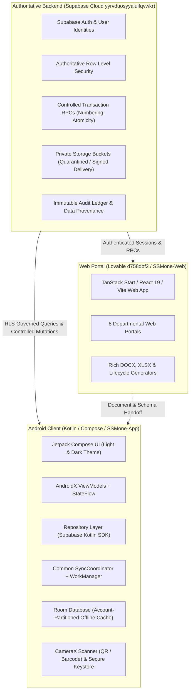
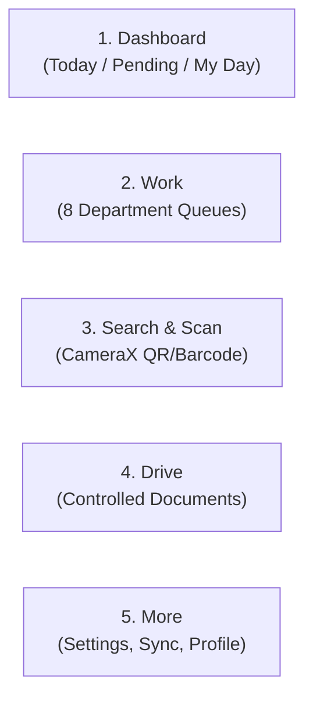
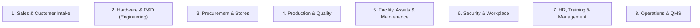
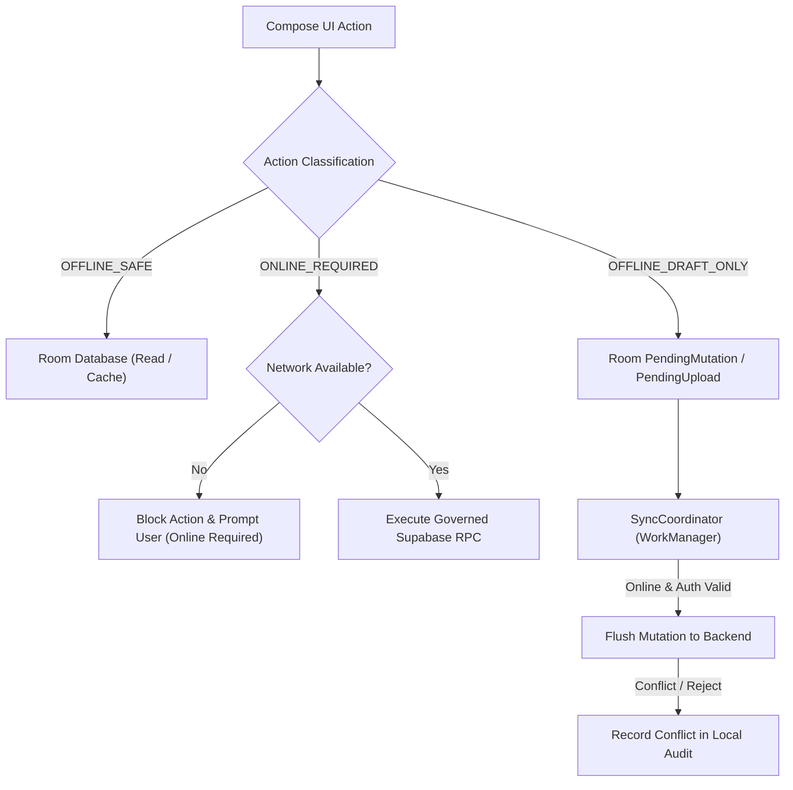
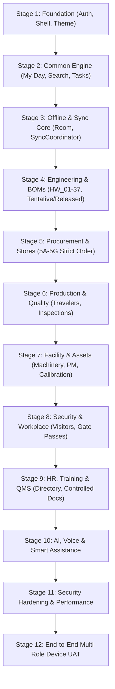

# SSMone-App — Android Mobile Managing Portal Master Plan

**Document Version:** 2.0 (Refined Architecture & Implementation Plan)  
**Date:** 18 October 2026  
**Target Repository:** `C:/Users/Admin/AndroidStudioProjects/SSMone/SSMone-App`
**Web / Backend Master Plan Reference:** [`SSMone-Web/docs/planning/SSM_ONE_WEB_PORTAL_MASTER_PLAN.md`](file:///C:/Users/Admin/AndroidStudioProjects/SSMone/SSMone-Web/docs/planning/SSM_ONE_WEB_PORTAL_MASTER_PLAN.md)
**Authoritative Backend Contracts:** [`docs/backend-handoff/mobile_backend_contract.json`](file:///C:/Users/Admin/AndroidStudioProjects/SSMone/SSMone-App/docs/backend-handoff/mobile_backend_contract.json), [`docs/backend-handoff/MOBILE_BACKEND_CONTRACT.md`](file:///C:/Users/Admin/AndroidStudioProjects/SSMone/SSMone-App/docs/backend-handoff/MOBILE_BACKEND_CONTRACT.md), [`docs/backend-handoff/ANDROID_BACKEND_HANDOFF.md`](file:///C:/Users/Admin/AndroidStudioProjects/SSMone/SSMone-App/docs/backend-handoff/ANDROID_BACKEND_HANDOFF.md)

---

## 1. Executive Purpose & Architectural Authority

The **SSM One Android Mobile Application** serves as the authoritative on-the-move managing and operational client for the SSM One enterprise platform. It enables engineers, storekeepers, technicians, quality inspectors, facility managers, security guards, and executives to monitor operations, scan hardware/assets/lots, execute verified draft workflows, inspect document revisions, and perform controlled transactions from Android handheld devices and tablets.

### 1.1 System Authority Split



### 1.2 Non-Negotiable Architecture Rules

1. **Backend Owns Truth**: The Supabase backend owns users, profiles, employees, roles, permissions, projects, inventory stock, official numbering, and transaction atomicity. The Android client never creates local source-of-truth business tables (e.g. no `mobile_inventory`, no `mobile_purchase_orders`).
2. **Credential Boundary**: The APK receives strictly `SUPABASE_URL` and `SUPABASE_ANON_OR_PUBLISHABLE_KEY`. It never contains `service_role`, database passwords, JWT signing secrets, or private OAuth secrets.
3. **RLS Authorization**: Authorization is strictly enforced by backend Row-Level Security. Android never overrides or replaces backend RLS with client-side UI hiding or locally cached roles. An empty response from Supabase represents denied access.
4. **Controlled Mutation Atomicity**: Critical inventory, asset, and document state changes (Final GRN, Material Issue, Material Return, Stock Transfer, Stock Adjustment, Document Release) must invoke designated server RPCs with client-generated UUID `request_key` idempotency tokens. Critical mutations remain `ONLINE_REQUIRED`.
5. **Single Common Sync Engine**: All offline caching, mutation queues, and background synchronization must use the common `SyncCoordinator`, Room database, and WorkManager infrastructure. Feature-specific synchronization daemons (e.g., `GrnSyncWorker`, `InventorySyncWorker`) are strictly prohibited.
6. **Package Path Discipline**: Package paths must not use Kotlin reserved words (e.g. use `feature.stores.returns`, never `feature.stores.return`).

---

## 2. Android Experience & UI Architecture

### 2.1 Five-Tab Navigation Framework

The application implements a predictable, thumb-accessible five-tab bottom navigation structure supplemented by a dynamic top operational bar:



1. **Dashboard (My Day)**:
   - Role-aware daily cockpit showing *Today's Tasks*, *Pending Actions*, and *Overdue Items*.
   - Filtered by the active presentation department, with quick links to assigned project cards and task checklists.
   - Honest metric presentation: unavailable or restricted metrics are clearly badged as *Restricted* or *Unavailable* rather than rendering dummy zeroes.
2. **Work (Departmental Operational Queues)**:
   - Primary operational surface exposing the 8 enterprise department workflows based on user permissions.
   - Filterable by department, status, project, and priority.
3. **Search & Scan**:
   - High-performance barcode and QR scanner using CameraX and ML Kit / ZXing.
   - Instantly resolves physical items to authoritative records: components (MPN), reels, storage bins, lots, asset tags, employee badges, travelers, and purchase orders.
   - Deep-linking engine navigates directly to the resolved entity detail screen.
4. **Drive (Controlled Documents & BOMs)**:
   - Scoped departmental document roots mirroring the web portal Drive taxonomy.
   - Exposes controlled document registers, revision timelines, version tags, and project BOM linkages.
   - Native read-only previewers for PDF, images, and tabular XLSX/BOM data.
5. **More (Administration & Connectivity)**:
   - User profile, department switcher (presentation alias, without privilege elevation).
   - Sync Coordinator center: visual status of pending offline drafts, sync logs, cache size, network health.
   - App settings, theme toggle (Light / Dark / System default).

### 2.2 Dark Mode & Material 3 Theming

The application adheres to Material Design 3 with comprehensive Light and Dark theme implementations that visually align with the SSM One web portal:

- **Dynamic Theme Palette**:
  - Light Palette: High-contrast slate and industrial blue accents, clean white/gray surfaces (`#F8FAFC`, `#FFFFFF`), subtle borders (`#E2E8F0`).
  - Dark Palette: Deep charcoal surfaces (`#090D16`, `#111827`, `#1E293B`), subdued text tones (`#F1F5F9`, `#94A3B8`), and vibrant indicator accents for active, warning, and success states.
- **Theme State Management**: Integrated into `Theme.kt`, observing system theme changes and providing an explicit user override stored in encrypted preferences.

---

## 3. Departmental Coverage (8 Workspaces)

The Android app provides operational mobile clients for all 8 enterprise departments:



### 3.1 Sales & Customer Intake
- **Mobile Scope**: Read-only commercial pipeline, active customer directories, assigned enquiries, and feasibility review status.
- **Key Tables**: `customers`, `customer_contacts`, `customer_requirements`, `customer_requirement_revisions`, `customer_portal_shares`.
- **Boundaries**: Customer quotations, pricing models, and contract signing remain web-authoritative. Mobile displays operational project links without exposing confidential financial margins.

### 3.2 Hardware & R&D (Engineering & BOM Management)
- **Mobile Scope**:
  - Project repository exploration (`projects`, `project_members`, `project_process_stage_records`).
  - Company Process Stage Tracking (Taxonomy HW_01 to HW_37) with predecessor lock indicators and evidence links.
  - **Tentative BOM vs. Released BOM Inspection**:
    * Full line-level stock match status (Exact Match, Substitute Available, Shortage, Unstocked).
    * Alternate component review rationale and datasheet links (`datasheet_cache`).
    * Revision comparison between Draft/Tentative engineering BOMs and Released production BOMs (`project_boms`).
  - Engineering Changes: Review active ECR/ECO records, linked tasks, and impacted parts.

### 3.3 Procurement & Stores (Stage 5 Detailed Delivery)
Procurement and Stores follow the strict staged execution sequence (5A through 5G):

- **5A — Procurement Read-Only**:
  - Safe operational projections: `operational_purchase_requests`, `operational_purchase_request_items`, `operational_rfqs`, `operational_po_shipments`, `operational_vendors`.
  - Excludes unit costs, margins, payment terms, and vendor bank accounts.
- **5B — Receiving Drafts**:
  - Scan PO barcode or ASN to load expected items via `operational_receiving_purchase_orders`.
  - Component verification: MPN scanning, lot number, batch code, date code, reel ID, packaging condition, MSL/ESD flags.
  - Photo evidence capture attached to local draft receiving vouchers.
  - Drafts saved locally in Room; strictly no offline Final GRN posting.
- **5C — Inventory Read-Only**:
  - Component search by MPN, manufacturer, description, category, or bin location (`components`, `inventory_lots`, `storage_locations`).
  - Stock visibility categorized as Available, Quality Hold / Quarantine, or Reserved.
  - Explicit *Cached / May-be-outdated* freshness timestamp on every stock screen.
- **5D — Material Issue & Return**:
  - Material Issue: Online posting via `post_material_issue` against valid project work orders.
  - Material Return: Online posting via `post_material_return` (package `feature.stores.returns`), preventing over-return atomically.
- **5E — Cycle Counts & Blind Picking**:
  - Assigned cycle count sheets with blind count support (system stock quantity hidden from count operator).
  - Pick list execution with barcode confirmation per line.
- **5F — Final GRN & Critical Stock Transactions**:
  - Online-only execution of `create_grn`, `post_stock_transfer`, and `post_stock_adjustment`.
  - Enforces client UUID idempotency tokens, server numbering, row-locking concurrency, and immutable audit logs.
- **Review-Based Import / Draft Handling**:
  - When PO or invoice data is scanned or imported from external supplier manifests, records are placed into a *Draft Review Queue*.
  - No inventory stock movement occurs until formally approved and received through the controlled receiving inspection gate.

### 3.4 Production & Quality
- **Mobile Scope**:
  - Traveler & Work Order Execution: `work_orders`, `production_routes`, `routing_steps`, `production_units`.
  - Step check-in/check-out with operator badge scan.
  - Quality Inspection: In-process and final inspection checklists (`inspection_records`, `ncr_records`).
  - Defect logging with camera photo evidence and quarantine tagging.
  - PPAP / First Article Inspection review summaries and dispatch packaging verification.

### 3.5 Facility, Assets & Maintenance
- **Mobile Scope**:
  - Asset Directory & Quick Scan: `assets`, `asset_categories`, `asset_assignments`.
  - Machinery Registers: Operating state, maintenance history, and assigned operators.
  - Preventive Maintenance (PM): Scheduled PM checklists with step-by-step sign-off and photo upload.
  - Breakdown Work Orders: Rapid breakdown ticket creation with priority rating, machine stoppage timer, and technician dispatch.
  - Calibration Logs: Measuring equipment calibration dates, certificate inspection, and out-of-calibration warnings (`calibration_records`).

### 3.6 Security & Workplace
- **Mobile Scope**:
  - Gatehouse Cockpit: Visitor check-in/check-out with badge generation (`visitor_logs`).
  - Material Gate Pass Verification: Inward and outward pass scanning against approved store transfers (`gate_passes`).
  - Vehicle Logistics: Truck entry/exit logging, driver details, and loading bay assignment.
  - Workplace Incident Reports: Hazard identification, injury reporting, and facility security patrols.

### 3.7 HR, Training & Management
- **Mobile Scope**:
  - Organization Directory: Department employee list with contact shortcuts (`employees`, `departments`).
  - Training & Competency Matrix: Verification of operator certifications before authorizing specialized machinery operation.
  - Personal Workspace: Leave application status, assigned training modules, and policy acknowledgements.

### 3.8 Operations & QMS (Quality Management System)
- **Mobile Scope**:
  - Controlled Document Viewer: RLS-governed access to company SOPs, manuals, work instructions, and specifications (`document_control_registers`, `document_control_events`).
  - Audit Trail Timeline: Real-time inspection of document revisions and change histories.
  - Audit & CAPA Inspection: Internal audit checklists, corrective action tracking, and KPI dashboard monitoring.

---

## 4. Offline Engine & Sync Architecture



### 4.1 Action Classification Rules

Every user action in the mobile app is strictly classified:

| Classification | Meaning | Examples |
|---|---|---|
| `OFFLINE_SAFE` | Read-only operations against cached Room tables. Stale indicators are displayed. | Browsing downloaded SOPs, reviewing cached component lists, viewing project directories. |
| `OFFLINE_DRAFT_ONLY` | Data entry that creates a local draft. Never changes server state until synced and verified online. | Receiving draft vouchers, cycle count observations, breakdown reports, visitor entries, inspection checklists. |
| `ONLINE_REQUIRED` | Cannot be performed offline. Must execute synchronously against Supabase with server-side validation and locking. | Final GRN creation, Material Issue, Material Return, Stock Transfers, Stock Adjustments, Document Release. |

### 4.2 Room Partitioning & Security

- Room database schemas are isolated per authenticated user account (`account_id` column on all cached tables).
- Logging out or switching accounts flushes uncommitted non-draft caches and resets repository state.
- Sensitive credentials, auth tokens, and session keys are kept exclusively in Android EncryptedSharedPreferences (backed by Android Keystore), never in plain Room tables.

---

## 5. Technical Implementation Stack & Directory Structure

### 5.1 Android Technology Stack

- **Language**: Kotlin 2.0+ (100% Kotlin, Coroutines, Flow).
- **UI Toolkit**: Jetpack Compose + Material 3, Navigation Compose.
- **Architecture**: Clean Architecture (Presentation → Domain → Data) + MVI / Unidirectional Data Flow.
- **Backend SDK**: Supabase Kotlin Client (`gotrue-kt`, `postgrest-kt`, `storage-kt`, `realtime-kt`).
- **Local Persistence**: Androidx Room with SQLite KSP compiler.
- **Background Work**: Androidx WorkManager with CoroutineWorker.
- **Hardware Integration**: CameraX (preview & image analysis), ML Kit Barcode Scanning / ZXing.
- **Dependency Injection / Factory**: Lightweight Repository & ViewModel providers adhering to Android lifecycle guidelines.

### 5.2 Source Code Directory Layout

```text
app/src/main/java/com/example/ssmapplication3/
├── MainActivity.kt                      # App entry point, theme provider, root navigation
├── core/
│   ├── auth/                            # Session manager, secure token storage, Google OAuth
│   ├── network/                         # SupabaseClientProvider, error parsers, interceptors
│   ├── security/                        # Capabilities, permission checkers, device security
│   ├── sync/                            # SyncCoordinator, PendingMutation, WorkManager workers
│   ├── ui/                              # Common Compose components, status badges, dialogs
│   └── util/                            # Environment config, Flow helpers, date formatters
├── data/
│   ├── local/                           # Room database, DAOs, local entity models
│   └── repository/                      # Repository implementations connecting Supabase & Room
├── domain/
│   ├── model/                           # Pure Kotlin business models & domain entities
│   └── repository/                      # Domain repository interfaces
├── feature/
│   ├── auth/                            # Sign-in screen, SSO callback, session restore
│   ├── dashboard/                       # My Day cockpit, today/pending checklists
│   ├── documents/                       # Drive document browser, controlled register viewer
│   ├── engineering/                     # Projects, BOM dual-lifecycle, stage tracking HW_01-37
│   ├── facility/                        # Asset register, PM checklists, breakdown reporting
│   ├── inventory/                       # Component lookup, lot/reel details, stock freshness
│   ├── mywork/                          # Unified work queue across permitted departments
│   ├── notifications/                   # Notification center, alert routing
│   ├── procurement/                     # PR, RFQ, PO, shipment tracking (safe projections)
│   ├── production/                      # Travelers, work orders, routing inspection
│   ├── receiving/                       # Receiving draft vouchers, PO item matching
│   ├── scanner/                         # CameraX barcode/QR scanner, deep-link resolver
│   ├── security/                        # Visitor logging, gate passes, vehicle registers
│   └── stores/                          # Critical stock transactions
│       ├── adjustments/                 # Stock adjustments (ONLINE_REQUIRED)
│       ├── issues/                      # Material issue posting (ONLINE_REQUIRED)
│       ├── returns/                     # Material return posting (ONLINE_REQUIRED)
│       └── transfers/                   # Stock transfers (ONLINE_REQUIRED)
├── navigation/                          # AppNavigation, Screen routes, DeepLinkHandler
└── ui/theme/                            # Color, Theme (Dark/Light), Type, Shape
```

---

## 6. Authoritative Handoff Contract Index

The Android client directly implements data structures and calls corresponding to the generated backend specifications:

| Backend Contract Artifact | Purpose & Android Mapping |
|---|---|
| [`mobile_backend_contract.json`](file:///C:/Users/Admin/AndroidStudioProjects/SSMone/SSMone-App/docs/backend-handoff/mobile_backend_contract.json) | Complete machine-readable catalog of all 180+ tables, foreign keys, columns, RPC signatures, and bucket paths. |
| [`MOBILE_BACKEND_CONTRACT.md`](file:///C:/Users/Admin/AndroidStudioProjects/SSMone/SSMone-App/docs/backend-handoff/MOBILE_BACKEND_CONTRACT.md) | Object classification matrix: `MOBILE_READ_SAFE`, `ONLINE_REQUIRED`, `WEB_ONLY`. |
| [`ANDROID_BACKEND_HANDOFF.md`](file:///C:/Users/Admin/AndroidStudioProjects/SSMone/SSMone-App/docs/backend-handoff/ANDROID_BACKEND_HANDOFF.md) | Safe configuration boundaries, operational projection specifications, RLS rules. |
| [`LIFECYCLE_ANDROID_READ_CONTRACT_2026-10-02.md`](file:///C:/Users/Admin/AndroidStudioProjects/SSMone/SSMone-App/docs/backend-handoff/LIFECYCLE_ANDROID_READ_CONTRACT_RENDERED_2026-10-03.txt) | Specification for displaying HW_01–HW_37 stages, department templates, and dependency chains. |
| [`VERIFIED_SAFE_PROCUREMENT_CONTRACT_2026-09-26.md`](file:///C:/Users/Admin/AndroidStudioProjects/SSMone/SSMone-App/docs/backend-handoff/VERIFIED_SAFE_PROCUREMENT_CONTRACT_2026-09-26.md) | Contract for `operational_*` safe views omitting financial/commercial data. |
| [`VERIFIED_MATERIAL_ISSUE_RETURN_CONTRACT_2026-09-27.md`](file:///C:/Users/Admin/AndroidStudioProjects/SSMone/SSMone-App/docs/backend-handoff/VERIFIED_MATERIAL_ISSUE_RETURN_CONTRACT_2026-09-27.md) | Signatures and idempotency rules for `post_material_issue` and `post_material_return`. |

---

## 7. Stage-by-Stage Implementation Roadmap

The mobile roadmap is organized into 12 controlled stages. Progress adheres to the strict engineering discipline: **INSPECT → IMPLEMENT → COMPILE → TEST → BUILD → DEVICE VERIFY → EVIDENCE → CONTINUE**.



### Stage 1: Foundation (COMPLETED / VERIFIED)
- Supabase auth integration (Email/Password, Google OAuth).
- Session manager with encrypted token storage.
- Navigation shell with 5-tab scaffold and top bar.
- Material 3 Theme foundation with Dark Mode and Light Mode support.

### Stage 2: Common Engine (COMPLETED / VERIFIED)
- Role-aware Dashboard / My Day cockpits with Today and Pending tasks.
- Unified task repository querying `project_tasks` partitioned by department.
- Deep link resolution foundation and notification badges.

### Stage 3: Offline & Sync Core (COMPLETED / VERIFIED)
- Room database schema with account isolation.
- Common `SyncCoordinator` handling draft queues (`PendingMutation`, `PendingUpload`).
- Network connectivity monitor and conflict resolution handlers.

### Stage 4: Engineering & R&D Workspace (IN PROGRESS / ACTIVE REFINEMENT)
- Project directory and project team exploration.
- Hardware process stages (HW_01 to HW_37) with predecessor lock indicators.
- **Tentative BOM vs Released BOM Inspection**:
  * Line-by-line stock match visualization (Exact, Substitute, Shortage).
  * Mouser component enrichment view (MPN, package, datasheet link).
  * Revision comparison between draft/tentative engineering BOMs and approved released production BOMs.
- Engineering Change Requests (ECR) and ECO impact review.

### Stage 5: Procurement, Stores & Receiving (STRICT 5A–5G SEQUENCE)
- **5A (Procurement Read-Only)**: PR, RFQ, PO, ASN, Vendor list using `operational_*` safe projections.
- **5B (Receiving Draft)**: PO/ASN selection, CameraX barcode scan matching, lot/batch/reel capture, draft voucher storage.
- **5C (Inventory Read-Only)**: MPN stock search, bin location lookup, stock freshness timestamps.
- **5D (Material Issue & Return)**: Online posting via `post_material_issue` and `post_material_return`.
- **5E (Cycle Counts & Picking)**: Blind count execution, pick lists with line-by-line verification.
- **5F (Final GRN & Critical Stock)**: `create_grn`, `post_stock_transfer`, `post_stock_adjustment` with UUID idempotency.
- **5G (Integration & Acceptance)**: End-to-end scanner, notifications, and regression test suite.

### Stage 6: Production & Quality Assurance
- Route station tracking and electronic travelers.
- Component lot traceability during assembly.
- In-process inspection, NCR creation with photos, PPAP sign-offs.

### Stage 7: Facility, Assets, Maintenance & Calibration
- Asset QR scanning and metadata cards (`assets`).
- Machinery operational state and breakdown ticketing.
- Preventive maintenance schedules with step checklists.
- Instrument calibration validity and certificate viewing (`calibration_records`).

### Stage 8: Security, Visitors & Workplace Logistics
- Gatehouse visitor check-in, pass generation, and host notifications.
- Material gate pass verification (inward / outward).
- Loading bay vehicle logs and incident report logging.

### Stage 9: HR, Training & Controlled Documents (QMS)
- Department staff directory and contact integration.
- Operator skill matrix verification.
- Controlled Document Register: RLS-permitted viewing of SOPs, manuals, and revision timelines.

### Stage 10: AI, Voice & Mobile Automation
- Voice-assisted inventory lookup and notes transcription.
- Intelligent scanner recognition for damaged packaging or illegible supplier labels.
- Scoped AI assistant answering procedural questions against cached SOPs.

### Stage 11: Security Hardening, Performance & Recovery
- Memory optimization and list virtualization for large BOMs and component catalogs.
- Safe file handling, sandboxed PDF rendering, and zero-cache leakage on logout.
- ProGuard / R8 code shrinking and security audit.

### Stage 12: End-to-End Multi-Role Acceptance Testing
- Live testing on physical Android devices across distinct test identities (Engineer, Storekeeper, Inspector, Manager).
- Verification of parity between web changes and mobile viewports.
- Full regression passing `:app:testDebugUnitTest` and clean `:app:assembleDebug` packaging.

---

## 8. Verification & Execution Gates

Every implementation increment must provide documented evidence meeting these gates before marking complete:

1. **Static & Syntax Gate**: `:app:compileDebugKotlin` exits with code `0`.
2. **Unit Test Gate**: `:app:testDebugUnitTest` passes all unit tests across data, domain, and ViewModels.
3. **Packaging Gate**: `:app:assembleDebug` successfully produces a valid debug APK.
4. **Device / Emulator Gate**: Verified on an Android emulator or physical device; screenshot or CLI log preserved in `docs/evidence/`.
5. **Contract Conformance Gate**: Network calls must conform strictly to `mobile_backend_contract.json` without inventing endpoints, columns, or tables.

## Workspace names — 18 October 2026

Web product: **SSMone**. Android application/display name: **SSMone-App**. Preferred workspace entry paths:
- Web: `C:/Users/Admin/AndroidStudioProjects/SSMone/SSMone-Web`
- Android: `C:/Users/Admin/AndroidStudioProjects/SSMone/SSMone-App`

Both SSMone-Web and SSMone-App are actual physical directories under C:/Users/Admin/AndroidStudioProjects/SSMone, with separate Git repositories and histories. Neither entry is a junction or duplicate checkout; this parent is not a monorepo. The former SSMOneWeb and SSMApplication3 roots no longer exist. Preserve historical backups, application/package identity, backend/project IDs and official document names. Use these physical workspace paths for new Studio/Antigravity sessions and schedulers.

## People self-service and shared intake planning boundary — 18 October 2026

User-requested scope; not implementation or device/backend acceptance. The web master plan section "People workspace and shared document intake — detailed UI delivery scope" owns the shared UX specification and backend work. This Android plan owns mobile delivery only; preserve the existing stage order and verified backend handoff gate.

- Web only: create/customize/publish leave and travel policies; configure entitlement, approval routing, audiences and templates. No editable policy administration on Android.
- Mobile: simple People overview, own leave balance/list/detail/request, calendar with List alternative, holidays, applicable policy reader and exact-version acknowledgement where required. Authorized team availability/approval is a separate backend capability; no blanket team personnel access or private leave reasons.
- Attendance and travel daily flows remain planned subject to explicit time/shift/eligibility/financial rules and verified contracts. No biometric, GPS, payroll or arbitrary entitlement assumptions.
- Reuse existing navigation, repositories, Room drafts and common SyncCoordinator. Label cached freshness; request drafts never promise automatic posting without a supported queued executor. Authoritative calculation, approvals and publication stay online-required.
- Shared Import document may accept supported files/photos/scans, present source and extracted fields for review, map to an authorized existing draft and preserve provenance. Reuse existing shared import contracts; never create mobile-only business documents/official numbers or post stock, finance or procurement actions from extraction.
- Customer-fill links must reuse accepted scoped resolver/publication/submit contracts. Copying a link never means issuing an invitation. A customer sees only allowed fields for the exact customer/document revision; expiry, revocation, replay and denied cross-customer access require acceptance.
- Verify employee identity and applicable policy from the server; UI/cached roles are not authority. Financial approval remains separately authorized management workflow, not implied by Sales import, Finance review or a client submission.

UI handoff: P01 overview; P02 own leave list; P03 request form; P04 detail/history; P05 calendar/agenda; P06 holidays; P07/P08 policy library/reader; P09/P10 scoped team approval/availability when accepted; P13/P14 attendance/travel only after rules. P11/P12 policy administration/settings remain web-only. I01-I05 shared intake/review/conversion/draft/customer-fill flows use phone-friendly focused screens, not a competing mobile document engine.

Acceptance must distinguish compile/tests/APK success, actual device flows and live least-privilege/readback acceptance. Use approved test identities only. No new mobile feature, production request, backend change or release was performed by this planning update.

### Assigned forms, training/reviews and reminders — 18 October 2026

Planning extension requested by the user; not implemented. Shared authoritative specification is the web master plan section "Training, recurring reviews, feedback forms and newsletter drafts". Mobile owns a simple assigned-forms inbox, one-column form fill with draft status, review/submit, durable receipt/detail/history, training assignments and scoped monthly self-review/feedback. Customer service feedback uses a separate accepted external audience and scoped link; it never exposes employee review records.

Authorized web administration owns template/version design, timing/audience/reviewer matrix, reminder cadence/quiet hours, effective dates and publication. Exact frequency/industry-standard applicability is not assumed. Mobile receives minimal private reminders and resolves current access when opening the assigned form. Completed/revoked/expired assignments do not reopen through stale notification links. Reuse existing notifications, navigation and common SyncCoordinator; offline forms are draft-only until a verified submission executor exists, retaining all fields and upload references. Submission and review require authoritative receipt/readback, current assignment, pinned template version and duplicate protection.

Newsletter generation is a backend/web reviewable draft from permitted verified project milestones, with source references and manual-edit preservation. No automatic approval or external sending. The user will supply reference folders/templates later; no claim of format inspection or folder access yet. Mobile newsletter viewing/review is not assumed until its audience and capability are accepted.

Detailed F01-F10 proposed UI screens are in the web plan; this update does not finalize their visual design. Verify ordinary employee/reviewer/customer access, denied private attachments, stale templates, interrupted drafts, notification deep links and real device behavior after accepted backend handoff. No live form/reminder/newsletter or production identity is created by this planning entry.

Client-view refinement: after accepted client/project-completion events, show the exact scoped journey-feedback assignment immediately; delivery and installation feedback have separate verified event triggers. Complaint/support ticket creation stays independently available to eligible authenticated clients, without waiting for a survey or Sales approval. Reuse accepted Service contracts and exact customer/project/order/device entitlement, not client role alone. Client project stages are the permitted published projection; customer Master inputs are scoped submissions for controlled review, never direct approved-baseline edits. Ticket list/detail exposes only customer-visible messages/attachments. Sales copying a support link never issues an invitation or access. Detailed events, proposed client navigation and denied/replay acceptance cases are in the web master plan. No mobile client feature or live trigger has been implemented by this planning update.

Explicit feature ownership and required contract packet: [People/client web-to-Android handoff — planned, not accepted](../backend-handoff/PEOPLE_CLIENT_WEB_ANDROID_HANDOFF_PLANNED_2026-10-18.md). This matrix binds web-only administration, shared backend authority and mobile UI/offline/readback obligations without treating a planning document as a live API.


Client mobile layout proposal for review: Home (scoped account summaries/next action), Projects (published stages and permitted department updates), Orders (production/shipment/delivery and customer-agreed prices/invoices), Support (eligible ticket/feedback). Required inputs open from Home/project detail. Customer/company registration is a separate pending intake reviewed by Sales and Finance before authorized activation; technical requirements and feasibility are separate source-pinned review flows. Mobile may capture scoped customer inputs but never auto-activate a customer, grant company access, approve Finance or overwrite a baseline. The illustrative client layout is synthetic/local-only, not live acceptance or a replacement of the approved internal project UI. Detailed mapping remains in the planned web-to-Android handoff document.

Flow-view planning refinement: mobile project/department views use a vertical lifecycle stepper and expandable dependency list sourced from the same accepted workflow records. Show owned work, upstream prerequisites, recorded blockers and next handoff; provide an accessible text alternative. Client gets only the authorized published journey projection. No automatic phase start/approval or new mobile workflow engine. Web plan owns exact shared diagram requirements and applicability.

Client design baseline approved: Home / Projects / central Scan-Verify / Orders / Support, with contextual Required Inputs/Feedback. Preserve the approved compact layout; no alternative redesign or image is requested. Scan or manual reference lookup must use an accepted scoped device/document resolver; camera denial falls back to manual entry. Show permitted recorded status/revision only; neither a match nor cached data proves physical authenticity/current release. Do not leak cross-customer records or turn scanning into approval/access/revision adoption.

Department Process Flow editing is planned as another authorized entry to the SAME web/backend settings contract, not an Android workflow engine. Lead menu visibility and editable node properties follow current capability; draft/validate/impact-review/activate are separate from runtime task/stage transitions. Backend must reject cycles, missing gates and unauthorized edits, preserve history and in-progress instances. Mobile may provide a readable stepper/detail and only accepted editing interactions; no authority inferred from the diagram.

Transfer to a future user-supplied repository/folder is pending its explicit destination and inspection. Keep this Android plan separate from web/backend plan and the planned handoff; no new project/backend is created or assumed, and no verified acceptance transfers automatically.

### R&D / Service visit inputs and generated test-report drafts

User-requested mobile scope: an explicitly assigned R&D or Service engineer, including R&D assigned to an initial service/customer test visit, records structured research/field-test observations using existing shared architecture. Screen: assigned project/visit and procedure/configuration pins; device/specimen; setup/environment/instrument references when required; repeatable parameter/method/criteria/readings/units/observation rows; evidence; limitations and next action. Distinguish unknown/not-tested/not-applicable; no inferred pass, fabricated value or signature approval.

Save typed records and read back the exact authoritative receipt first. Then request/observe idempotent source/template-pinned report DRAFT generation; expose queued/generating/failed/ready truthfully. Preserve manual report edits with revision/diff; automatic drafting never means review/release. Customer/internal identity and header/footer come from actual scoped project/template. Reuse existing Room drafts, PendingUpload and SyncCoordinator, preserving every field/reference offline. Final submission/review/release and authoritative sync require accepted contracts; no feature-specific worker or new mobile backend.

Verify ordinary assigned engineer and cross-project denial, stale pins, typed units/criteria, complete offline recovery, attachment access, save/readback and generation replay/manual-edit preservation. Build/device/backend acceptance are separate. Supplied reference templates/folders remain pending actual access; no live report or cloud upload is created here.

### Confirmed template preparation/review boundary and MOM sharing

Supersedes exploratory external-editor discussion: Google Drive/Docs/Sheets API integration is not selected scope. Web-only authorized department template maintainers manage their scoped layout/header/footer/revisions. Android team members fill/verify only permitted assigned document-instance data/tables/evidence; project auto-fill stays source-pinned, and Prepared by is the authenticated assigned preparer from the recorded submission.

Shared workflow: member prepares/submits > department lead reviews, edits with revision history or returns > applicable management approval (default product/hardware CPO, software CTO, Sales/Finance/business/money CEO), followed by separately authorized release/publication. Route is a capability-controlled versioned matrix editable through the same accepted settings/Process Flow contract; department lead status alone cannot change executive routing or bypass gates. Mixed-scope documents resolve applicable stages explicitly; missing approver blocks the affected action. Material edits invalidate affected prior decisions. Mobile decisions are online-required and bind exact revision/readback.

Site-visit MOM/report is visible to clients in web/mobile only at its accepted client-visible revision, with an authorized notification. Copy email subject/content provides permitted project/MOM details for MANUAL sending; it does not create a mailbox draft, send mail, grant access or guarantee threading by subject. General project remarks remain in existing client analysis. No live template privilege, management decision, email automation or Google connection is enabled here.


Company-name anonymization: current repository display labels, planning/reference snapshots and synthetic examples use XYZ Pvt Ltd. Live business records, identities, backend configuration, official document codes and published Git history were not changed. Sanitized schema/reference text is not a claim of an altered installed database. Image/binary contents and historical commits require separate review; a source sync is not deployment.
